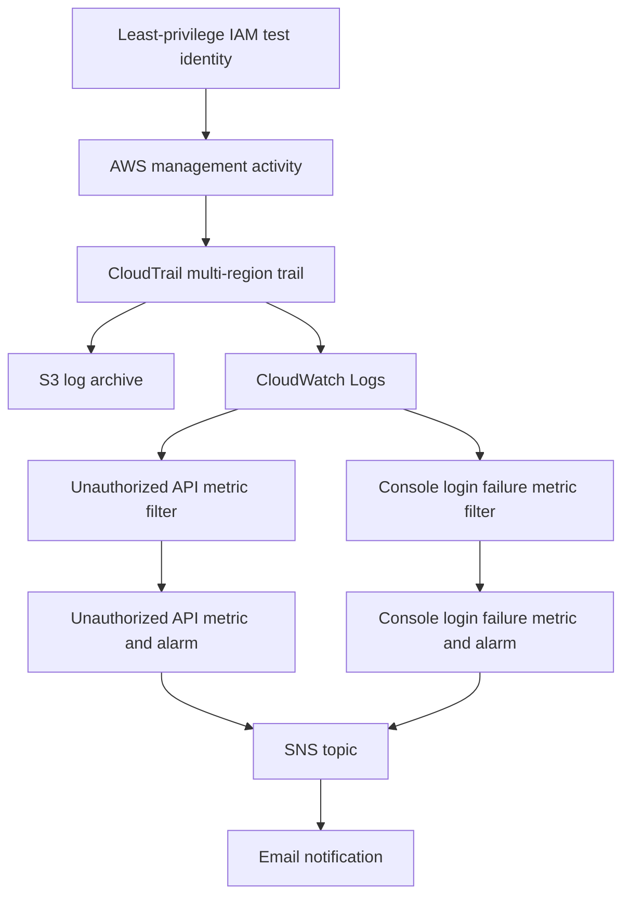

# AWS Cloud Security Monitoring Lab

A hands-on AWS security-monitoring project demonstrating centralized audit logging, least-privilege access validation, CloudWatch-based detection, and email alerting.

**Project outcome:** The unauthorized API-call detection workflow was verified end to end. The failed-console-login alarm is configured, and its SNS email action was tested separately; the real failed-login event-to-alarm path remains unverified because no matching `ConsoleLogin` events were found in the investigated Sydney Event history view.

## Project objectives

- Centralize AWS management activity using a multi-region CloudTrail trail.
- Deliver audit records to an S3 archive and CloudWatch Logs.
- Validate least-privilege IAM permissions with both successful and denied S3 operations.
- Convert matching security events into CloudWatch metrics and alarm states.
- Notify a confirmed email subscriber through Amazon SNS.
- Document test evidence, monitoring boundaries, and current cost observations.

## Architecture

The detailed architecture and verification boundaries are available in [Architecture](architecture/architecture.md).

## AWS services and configuration

| Service | Role in the project | Recorded configuration |
|---|---|---|
| AWS CloudTrail | Collects AWS management activity | Multi-region trail: `Cloudsec-lab-trail` |
| Amazon S3 | Archives CloudTrail log files | Private destination; bucket identifier omitted from public documentation |
| Amazon CloudWatch Logs | Stores searchable log events | `/aws/cloudtrail/security-lab`; 7-day retention |
| Amazon CloudWatch | Extracts metrics and evaluates alert conditions | Metric filters and two alarms |
| Amazon SNS | Delivers alarm notifications | `cloudsec-lab-alerts`; email subscription confirmed |
| AWS IAM | Validates least-privilege access | `cloudsec-lab-reader` restricted to a designated test bucket |

## Detection and validation results

| Scenario | Detection configuration | Observed result |
|---|---|---|
| Unauthorized API request | `UnauthorizedApiCallsFilter`; alarm threshold `>= 1` matching metric unit in 5 minutes | **End-to-end verified.** A denied `ListBuckets` request was logged, the alarm entered `ALARM`, an email arrived, and the alarm later returned to `OK`. |
| Failed AWS console sign-in | `ConsoleLoginFailuresFilter`; alarm threshold `>= 3` matching metric units in 5 minutes | **Configured; real event path unverified.** Manual alarm-state testing confirmed SNS email delivery, but no matching `ConsoleLogin` event was found in the investigated Sydney Event history view. |

The exact filter patterns, observed outcomes, and validation limitations are documented in [Testing Results](docs/testing-results.md).

## Least-privilege validation

The `cloudsec-lab-reader` identity successfully listed objects in its permitted test bucket and downloaded `test.txt`. A request to list all buckets was denied because `s3:ListAllMyBuckets` was not granted. The denial was recorded and drove the verified unauthorized API alert workflow.

## Cost snapshot

Billing was reviewed on **20 October 2026**. The account dashboard showed **$0.00 amount due**, **$99.99 in remaining credits**, **$0.01 month-to-date usage**, and a Free plan end date of **14 April 2027**. The cost-by-project dashboard reported usage covered by available Free Tier credits. The displayed service breakdown attributed the $0.01 to Amazon S3; the exact bucket and operation were not identified.

This is a point-in-time account observation, not a guarantee of future zero cost. See [Cost and Security Review](docs/cost-and-security-review.md).

## Security considerations and limitations

- CloudWatch Logs retention is configured for 7 days; this setting does not establish retention for the S3 archive.
- At the time of the recorded review, explicit SSE-KMS configuration for the CloudTrail S3 destination had not been enabled. The bucket's default encryption configuration should be evaluated separately.
- Real failed-console-login detection is not claimed as end-to-end verified.
- The design is an educational lab, not a production-ready security monitoring baseline.
- Public repository content excludes AWS access keys, secret keys, passwords, session tokens, and raw credentials. Account-specific bucket identifiers and notification addresses are omitted.

## Repository contents

- [Architecture](architecture/architecture.md) — component relationships and telemetry flow.
- [Implementation Details](docs/implementation-details.md) — deployed configuration and representative validation commands.
- [Testing Results](docs/testing-results.md) — outcomes, evidence boundaries, and outstanding verification.
- [Cost and Security Review](docs/cost-and-security-review.md) — billing snapshot, security observations, and resource-lifecycle considerations.
- [Evidence Index](screenshots/README.md) — screenshot evidence catalogue.

## References

- [AWS CloudTrail event history](https://docs.aws.amazon.com/awscloudtrail/latest/userguide/view-cloudtrail-events.html)
- [AWS Management Console sign-in events](https://docs.aws.amazon.com/awscloudtrail/latest/userguide/cloudtrail-event-reference-aws-console-sign-in-events.html)
- [CloudWatch Logs metric filters](https://docs.aws.amazon.com/AmazonCloudWatch/latest/logs/MonitoringLogData.html)
- [CloudWatch alarms and email notifications](https://docs.aws.amazon.com/AmazonCloudWatch/latest/monitoring/AlarmThatSendsEmail.html)
- [IAM security best practices](https://docs.aws.amazon.com/IAM/latest/UserGuide/best-practices.html)

---

**Project type:** Cloud security monitoring / AWS hands-on lab.
