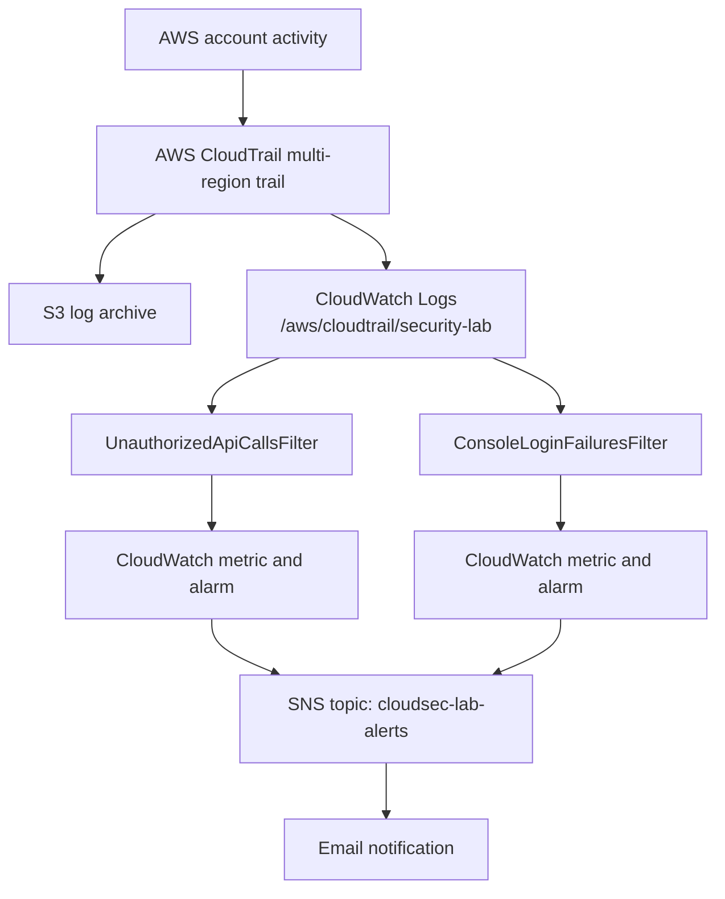

# AWS Cloud Security Monitoring Lab

A hands-on AWS lab demonstrating centralized CloudTrail logging, CloudWatch log analysis, least-privilege IAM validation, and email notifications for security-relevant activity.

> **Project status:** The unauthorized API-call alert path has been tested end to end. The ConsoleLogin alarm's **email action** was tested by manually setting the alarm state, but the real failed-sign-in event-to-alarm path is still pending validation. See [Testing results](docs/testing-results.md).

## Architecture



A larger editable Mermaid diagram is in [`architecture/architecture.md`](architecture/architecture.md).

## AWS services used

- **AWS CloudTrail** — multi-region management-event collection using the trail `Cloudsec-lab-trail`.
- **Amazon S3** — archive destination for CloudTrail logs. The bucket name and account ID are intentionally omitted from this public documentation.
- **Amazon CloudWatch Logs** — log group `/aws/cloudtrail/security-lab`, configured with 7-day retention.
- **CloudWatch metric filters and alarms** — detect unauthorized API calls and failed console sign-in events.
- **Amazon SNS** — topic `cloudsec-lab-alerts` sends alarm notifications to a confirmed email subscription.
- **AWS IAM** — `cloudsec-lab-reader` tests least-privilege access to a designated lab bucket.

## Detection rules

| Detection | Metric | Alarm threshold | Status |
|---|---|---|---|
| Unauthorized API calls | `CloudSecLab / UnauthorizedApiCalls` | At least 1 matching event in a 5-minute period | **Verified:** a denied `ListBuckets` request generated an alert email; alarm later returned to `OK`. |
| Failed console sign-ins | `CloudSecLab / ConsoleLoginFailures` | At least 3 matching events in a 5-minute period | **Partially verified:** manual alarm-state test generated an email; actual `ConsoleLogin` events were not found in the selected Sydney Event history view. |

The unauthorized API metric filter pattern is:

```text
{($.errorCode="*UnauthorizedOperation") || ($.errorCode="AccessDenied*")}
```

The failed sign-in filter pattern is:

```text
{ ($.eventSource = "signin.amazonaws.com") && ($.eventName = "ConsoleLogin") && ($.responseElements.ConsoleLogin = "Failure") }
```

Because the failed-login event was not found in Event history for the selected region, do not describe the real failed-login detection workflow as fully verified yet. CloudTrail sign-in event Region varies by user type and sign-in endpoint; see the official [AWS Console sign-in event reference](https://docs.aws.amazon.com/awscloudtrail/latest/userguide/cloudtrail-event-reference-aws-console-sign-in-events.html).

## Least-privilege validation

The IAM user `cloudsec-lab-reader` was able to list objects in its permitted lab bucket and download `test.txt`. A request to list every bucket was denied because the policy intentionally did not grant `s3:ListAllMyBuckets`. The denial was visible in CloudTrail and triggered `UnauthorizedApiCallsAlarm`.

Example command (requires the local AWS CLI profile to already be configured):

```bash
aws s3api list-buckets --profile cloudsec-lab-reader
```

Expected outcome for this lab's restricted user: `AccessDenied` for `s3:ListAllMyBuckets`. Do not broaden the policy just to make this command succeed.

## Repository layout

```text
.
├── README.md
├── .gitignore
├── architecture/
│   └── architecture.md
├── docs/
│   ├── setup-guide.md
│   ├── testing-results.md
│   └── cost-and-cleanup.md
└── screenshots/
    └── README.md
```

## Security and cost notes

- Do not commit AWS access keys, secret keys, passwords, session tokens, raw credentials, or unredacted account-sensitive logs.
- Screenshots should hide account IDs, email addresses, public IP addresses where unnecessary, bucket names if desired, and other personal or sensitive details.
- CloudWatch Logs retention is set to 7 days. This does **not** set retention on the S3 archive.
- At the time of the lab review, SSE-KMS encryption had not been enabled for the CloudTrail S3 destination. Review the bucket's default encryption and access controls before using this design for production.
- Review AWS Billing and Cost Management for actual charges; costs depend on usage, Region, and account eligibility.

## Documentation

- [Setup guide](docs/setup-guide.md)
- [Testing results](docs/testing-results.md)
- [Cost review and cleanup](docs/cost-and-cleanup.md)
- [Architecture diagram](architecture/architecture.md)

## References

- [AWS CloudTrail: View event history](https://docs.aws.amazon.com/awscloudtrail/latest/userguide/view-cloudtrail-events.html)
- [AWS CloudTrail: AWS Management Console sign-in events](https://docs.aws.amazon.com/awscloudtrail/latest/userguide/cloudtrail-event-reference-aws-console-sign-in-events.html)
- [CloudWatch Logs: Metric filters](https://docs.aws.amazon.com/AmazonCloudWatch/latest/logs/MonitoringLogData.html)
- [CloudWatch alarms](https://docs.aws.amazon.com/AmazonCloudWatch/latest/monitoring/AlarmThatSendsEmail.html)
- [IAM best practices](https://docs.aws.amazon.com/IAM/latest/UserGuide/best-practices.html)

---

**Learning project only.** This setup is a lab, not a complete production security-monitoring architecture.
