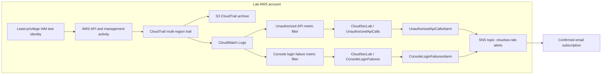

# Architecture and Data Flow

## Overview

The lab centralizes AWS management activity, stores audit records in both an S3 archive and CloudWatch Logs, evaluates two security detection rules, and routes CloudWatch alarm notifications through Amazon SNS to a confirmed email subscription.

## Components

| Component | Role | Recorded configuration |
|---|---|---|
| CloudTrail | Audit-event collection | `Cloudsec-lab-trail`; multi-region trail |
| Amazon S3 | Audit log archive | Destination bucket identifier omitted from public documentation |
| CloudWatch Logs | Searchable event stream | `/aws/cloudtrail/security-lab`; 7-day retention |
| Unauthorized API filter | Detects API errors with unauthorized/denied codes | `UnauthorizedApiCallsFilter` |
| Unauthorized API alarm | Signals matching denied API activity | Sum over 5 minutes; threshold `>= 1` |
| Console login failure filter | Matches the configured failed `ConsoleLogin` event fields | `ConsoleLoginFailuresFilter` |
| Console login alarm | Signals matching failed sign-in metric volume | Sum over 5 minutes; threshold `>= 3` |
| Amazon SNS | Alert transport | `cloudsec-lab-alerts`; confirmed email subscription |
| IAM test identity | Exercises restricted S3 access | `cloudsec-lab-reader` |

## Validation boundary

The unauthorized API workflow was exercised with a denied account-wide bucket-list request. CloudTrail recorded the denial, the metric filter and alarm responded, an email arrived, and the alarm later returned to `OK`. This path was verified end to end.

The ConsoleLogin alarm's notification action was tested by manually setting the alarm state to `ALARM`, which produced an email. A matching real failed-login event was not observed in the investigated Sydney Event history view. Therefore, the console-login detector is configured but its real event-to-metric-to-alarm behavior is not claimed as verified.

## Security and operations considerations

CloudWatch Logs retention is 7 days and should not be confused with S3 archive retention. Explicit SSE-KMS configuration for the CloudTrail S3 destination had not been enabled at the time of the recorded review; actual bucket default encryption was not inferred from that fact. Public project materials omit sensitive account-specific identifiers and credentials.

This architecture demonstrates core cloud monitoring concepts. It is not a full production security operations platform; broader event coverage, protected log retention, encryption, incident response, and sustained cost review would be required for production adoption.
