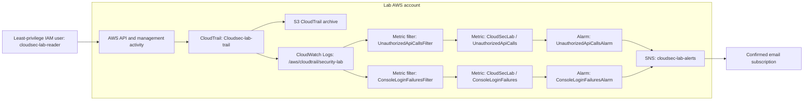

# Architecture

## Data flow

## Components

| Component | Configuration / purpose |
|---|---|
| Trail | `Cloudsec-lab-trail`; multi-region CloudTrail trail |
| S3 destination | CloudTrail log archive; bucket name intentionally excluded from public docs |
| CloudWatch Logs | `/aws/cloudtrail/security-lab`; retention set to 7 days |
| Unauthorized API filter | Matches `UnauthorizedOperation` or `AccessDenied*` error codes |
| Unauthorized API alarm | Sum, 5-minute period, threshold `>= 1` data point; SNS action enabled |
| Failed console login filter | Matches `signin.amazonaws.com`, event `ConsoleLogin`, and `responseElements.ConsoleLogin = Failure` |
| Failed console login alarm | Sum, 5-minute period, threshold `>= 3` data points; SNS action enabled |
| SNS topic | `cloudsec-lab-alerts`; email subscription confirmed and tested |
| Least-privilege user | `cloudsec-lab-reader`; limited read access to the designated test bucket |

## Verification boundary

The unauthorized API rule was tested with a denied `s3:ListAllMyBuckets` request. The alarm entered `ALARM`, an alert email arrived, and the alarm later returned to `OK`.

The failed-console-login alarm notification action was tested separately by manually setting its state to `ALARM`, which generated an email. CloudTrail Event history in the Sydney Region did not return a `ConsoleLogin` event during the investigated time range, so the real event → metric filter → alarm path remains unverified.

## Design intent

This is a learning lab, not a production-ready security architecture. Review log protection, encryption, access policies, retention, monitoring coverage, and cost before adapting it for a real environment.
